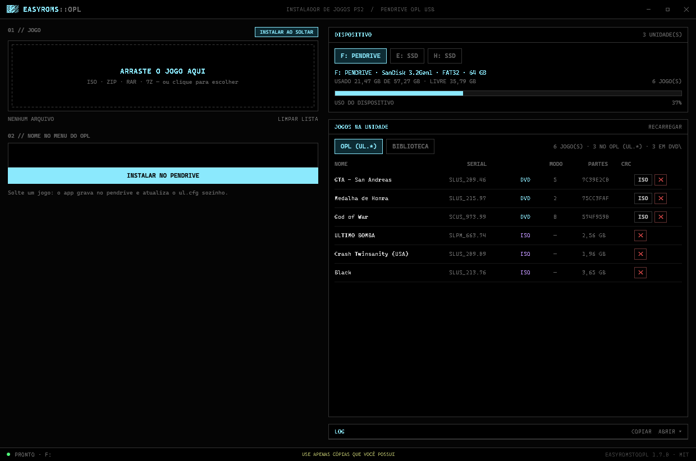

# EasyRomsToOPL

**Adicione jogos de PS2 a um pendrive do OPL (Open PS2 Loader) — arrastando o arquivo ou em um comando. Sem USBUtil, sem quebrar o `ul.cfg`.**


**Interface gráfica** (arrastar e soltar) e **CLI** — as duas usando o mesmo motor.

---

## Interface gráfica



Abra com **duplo clique em `EasyRomsToOPL.cmd`** (ou rode `gui\EasyRomsToOPL.GUI.ps1`).
Sem instalação, sem Electron, sem runtime extra: é WPF nativo do Windows.

- **Arraste os `.iso`** para a área pontilhada (ou clique para escolher vários).
- O serial é **lido do `SYSTEM.CNF`** na hora e mostrado antes de gravar.
- Escolha **UL.\* (1 GiB)** ou **DVD (ISO < 4 GB)** — com validação de tamanho.
- **SIMULAR** gera o plano completo no log sem escrever nada.
- **INSTALAR** mostra progresso real (bytes, %), log com timestamp e aviso de duplicados.
- **JOGOS NO PENDRIVE** lista o que já está lá, com CRC e número de pedaços.
- Botão **ISO** remonta os pedaços de um jogo em `.iso` único (para PCSX2 ou backup).
- Botão **✕** remove um jogo (pedaços + entrada do `ul.cfg`), com confirmação.
- Unidades fixas aparecem marcadas com `HD` — o padrão é sempre o pendrive removível.
- **Pendrive em tempo real:** conecte ou remova com o programa aberto — a unidade
  aparece/some sozinha em até 1 s, sem precisar clicar em RECARREGAR. Se o pendrive
  selecionado sair, o app avisa e escolhe outro automaticamente.

O visual segue os tokens do `terminal.css` (a biblioteca de componentes usada como
referência): fundo `#050505`, ciano `#8BE9FD`, JetBrains Mono com fallback para
Cascadia/Consolas, bordas de 1px e nada de cantos arredondados.

## O problema

O OPL não lê `.iso` solto na raiz do pendrive. Ele espera o formato **`ul.*`**: a imagem
cortada em pedaços de exatamente **1 GiB** (`00`, `01`, `02`…) mais uma entrada binária
de 64 bytes no `ul.cfg`. E o nome dos pedaços depende de um **CRC32 não-padrão** que o
OPL calcula do nome do jogo — se errar um byte, o jogo aparece na lista e não abre.

Na prática, o caminho comum é abrir um programa de interface gráfica antigo, arrastar o
ISO, torcer, e depois descobrir que o jogo não aparece no console.

## A solução

Um script PowerShell que faz o trabalho **correto e verificável**:

```powershell
.\EasyRomsToOPL.ps1 -Iso "E:\jogos\God of War (USA).iso" -Nome "God of War"
```

Ele lê o serial de verdade de dentro do ISO, divide, grava os pedaços, escreve a entrada
no `ul.cfg` e confere o tamanho no final. O CRC foi **validado contra jogos instalados
por ferramentas oficiais** — os testes comparam com vetores reais (`7C39E2C0`, `75CC3FAF`).

| O que o script faz | Por que importa |
|---|---|
| Lê o `SYSTEM.CNF` do ISO | Descobre o serial real (`SLUS_209.46`), sem adivinhar pelo nome do arquivo |
| Calcula o `USBA_crc32` do OPL | O nome dos pedaços sai idêntico ao que o console espera |
| Divide em pedaços de 1 GiB | Contorna o limite de 4 GB do FAT32 |
| Escreve a entrada de 64 bytes | Sem isso o OPL lista o jogo, mas não acha os arquivos |
| Confere o total gravado | Falha alto em vez de deixar um jogo corrompido |
| `-DryRun` | Mostra o plano completo sem gravar um byte |

---

## Quickstart (CLI)

```powershell
# 1. clone
git clone https://github.com/lucao019/easyromstooplps2.git
cd easyromstooplps2

# 2. veja o que já está no pendrive (F: por padrão)
.\EasyRomsToOPL.ps1 -Listar

# 3. simule a instalação
.\EasyRomsToOPL.ps1 -Iso "E:\jogos\Shadow of the Colossus.iso" -DryRun

# 4. instale
.\EasyRomsToOPL.ps1 -Iso "E:\jogos\Shadow of the Colossus.iso" -Nome "Shadow of the Colossus"
```

No PS2: ligue o console → FMCB → **OPL → USB** → o jogo está na lista.

---

## Requisitos

- **Windows 10/11** com PowerShell 5.1 (já vem no sistema) ou PowerShell 7+.
- Pendrive formatado em **FAT32** (MBR). É o que o OPL entende.
- Um **ISO de PS2 íntegro** (`.iso`).
- PS2 com **FreeMcBoot** no memory card e o **OPL** instalado — o pendrive não dá boot
  sozinho, quem carrega o OPL é o memory card.

## Instalação

Nada de dependências: nem Node, nem Electron, nem módulo PowerShell.

### Instalador (recomendado)

Baixe **`dist/Instalar-EasyRomsToOPL.cmd`** (um arquivo só, ~170 KB) e dê duplo clique.
Ele instala em `%LOCALAPPDATA%\EasyRomsToOPL` e cria os atalhos:

- **Área de Trabalho** → `EasyRomsToOPL`
- **Menu Iniciar** → `EasyRomsToOPL` (com o **Desinstalar** ao lado)

Não pede administrador e não escreve no registro. Para remover, use o atalho
*Desinstalar* do Menu Iniciar — sobram zero arquivos.

### A partir do repositório

```powershell
git clone https://github.com/lucao019/easyromstooplps2.git
cd easyromstooplps2
```

Depois, duplo clique em `Instalar-EasyRomsToOPL.cmd` — ou, se preferir não instalar nada,
use direto da pasta:

- **Interface:** `EasyRomsToOPL.cmd`
- **CLI:** `.\EasyRomsToOPL.ps1 -Listar`

Se o Windows bloquear a execução:

```powershell
Set-ExecutionPolicy -Scope Process -ExecutionPolicy Bypass
```

Ou rode direto, sem mexer na política do sistema:

```powershell
powershell -NoProfile -ExecutionPolicy Bypass -File .\EasyRomsToOPL.ps1 -Listar
```

A GUI também aceita parâmetros, útil para criar um atalho ou usar "Abrir com":

```powershell
powershell -File .\gui\EasyRomsToOPL.GUI.ps1 -Drive F -Iso "E:\jogos\Okami.iso"
```

> O atalho aponta para o PowerShell com a janela escondida — por isso não existe `.exe`:
> o programa é 100% script, e um executável só existiria para embrulhar o mesmo comando.

## Uso (CLI)

```
.\EasyRomsToOPL.ps1 [-Iso <caminho>] [-Drive <letra>] [-Nome <nome>] [-Serial <serial>]
                    [-DvdFolder] [-DryRun] [-Listar] [-Force]
```

| Parâmetro | Descrição |
|---|---|
| `-Iso` | Caminho do ISO de PS2. Obrigatório, exceto com `-Listar`. |
| `-Drive` | Letra do pendrive. Padrão: `F`. |
| `-Nome` | Nome exibido no menu do OPL (máx. 32 caracteres, sem acento). Padrão: nome do arquivo. |
| `-Serial` | Força o serial. Normalmente é lido do próprio ISO. |
| `-DvdFolder` | Copia como `.iso` inteiro na pasta `DVD\` (só abaixo de 4 GB). |
| `-DryRun` | Mostra tudo o que faria, sem gravar nada. |
| `-Listar` | Lista os jogos `ul.*` e os ISOs soltos, e mostra o espaço livre. |
| `-Force` | Substitui um jogo que já exista com o mesmo serial. |

### Exemplos reais

```powershell
# listar o pendrive
.\EasyRomsToOPL.ps1 -Listar

# pendrive em outra letra
.\EasyRomsToOPL.ps1 -Iso "C:\isos\Okami.iso" -Drive G

# jogo pequeno, direto na pasta DVD (sem dividir)
.\EasyRomsToOPL.ps1 -Iso "C:\isos\Katamari.iso" -DvdFolder

# substituir um jogo já instalado
.\EasyRomsToOPL.ps1 -Iso "C:\isos\GTA.iso" -Nome "GTA - San Andreas" -Force
```

Saída típica:

```
Modo: formato ul.* (padrão do OPL para USB)
  Nome    : God of War
  Serial  : SCUS_973.99
  Mídia   : DVD
  Tamanho : 7,94 GB
  Partes  : 8 x 1 GiB
  Arquivos: ul.574F9590.SCUS_973.99.00 .. ul.574F9590.SCUS_973.99.07
  ul.cfg  : +1 entrada de 64 bytes

  parte 1/8 gravada (1,00 GB)
  ...
Pronto! 'God of War' (SCUS_973.99) adicionado.
```

---

## Como funciona

1. **Validação** — abre o ISO, lê o *Primary Volume Descriptor* em `0x8000`, confirma
   `CD001` + `PLAYSTATION` e extrai o serial do `SYSTEM.CNF` (`BOOT2 = cdrom0:\SLUS_209.46;1`).
   Se não for jogo de PS2, para antes de escrever qualquer coisa.
2. **Planejamento** — calcula quantos pedaços de 1 GiB são necessários, a mídia
   (`0x14` DVD / `0x12` CD) e o nome de cada pedaço:
   `ul.<CRC32 do nome>.<serial>.<NN>`.
3. **Gravação** — copia em blocos de 8 MB, um arquivo por pedaço, e soma os bytes no final.
4. **Índice** — anexa 64 bytes ao `ul.cfg`. Em caso de erro no meio do caminho, apaga os
   pedaços já gravados para não deixar lixo no FAT32.

O formato completo, com offsets e o detalhe do CRC, está em
[`docs/UL-FORMAT.md`](docs/UL-FORMAT.md).

CLI e GUI não têm código duplicado: as duas chamam as mesmas funções de
`lib/UlFormat.ps1` (`Install-UlGame`, `Install-DvdFolderGame`, `Remove-UlGame`,
`Export-UlToIso`). A GUI só acrescenta a camada visual e roda a cópia em um runspace
separado (`gui/Worker.ps1`) para não travar a janela.

## Limitações (leia antes de culpar o script)

- **USB 1.1 do PS2 ≈ 1 MB/s.** Isso é ~5x mais lento que o DVD do console. Jogos com
  muito streaming (GTA, God of War, corrida) engasgam em vídeos e trocas de área.
- **FAT32 não aceita arquivo ≥ 4 GB.** Por isso o formato `ul.*` existe. A pasta `DVD\`
  só serve para ISOs abaixo de 4 GB.
- **DVD9 (7–8 GB)** funciona, mas vira 8 pedaços e sofre mais no barramento lento.
- **Fragmentação** degrada a leitura. Instale com o pendrive o mais vazio possível.
- **Não converte formato.** O script instala `.iso`; se você tem `.zso`/`.chd`, converta
  antes (o OPL também aceita `zso` em versões recentes, mas este script não gera).
- **Não baixa jogos.** Ele só move arquivos que você já tem.

## Troubleshooting

| Sintoma | Causa provável | Solução |
|---|---|---|
| Jogo aparece na lista e volta ao menu | Nome do pedaço/CRC errado | Reinstale com este script; ele calcula o CRC do OPL |
| Jogo não aparece de jeito nenhum | Entrada ausente no `ul.cfg` | Rode `-Listar`; se não listar, reinstale |
| Travamento em cena específica | Velocidade do USB / jogo exigente | No OPL: **Select → Mode 1** ou **Mode 3** |
| Erro "Já existe um jogo com o serial" | Mesmo jogo já instalado | Use `-Force` para substituir |
| Erro de espaço | Pendrive cheio | Libere espaço; o script precisa do tamanho do ISO + 4 KB |
| "Unidade F:\ não encontrada" | Letra do pendrive mudou | Use `-Drive G` (ou a letra correta) |
| Pendrive não monta / arquivos somem | Remoção sem ejetar | **Sempre** use "Ejetar com segurança"; FAT32 corrompe fácil |

## Testes

```powershell
# 17 asserções do formato (CRC, entrada de 64 bytes, nomes, normalização)
.\tests\Test-UlFormat.ps1

# inclui a leitura de um ISO real
.\tests\Test-UlFormat.ps1 -IsoPath "E:\jogos\God of War (USA).iso"

# 20 asserções do worker da GUI: instala, exporta, cancela
.\tests\Test-GuiWorker.ps1

# 100 asserções da interface: clica em todo controle, instala e remove de verdade
.\tests\Test-GuiUi.ps1
```

```
CRC do OPL (USBA_crc32)
  [PASS] GTA - San Andreas
  [PASS] Medalha de Honra
  ...
Resultado: 17 passaram, 0 falharam
```

Os vetores de CRC não foram inventados: saíram de um pendrive real, com jogos instalados
por ferramenta oficial. Se os testes passam, o CRC é bit a bit o do OPL.

O `Test-GuiWorker.ps1` roda o **mesmo** `gui/Worker.ps1` que a interface usa, num
diretório temporário: instala um ISO real, remonta o `.iso`, confere serial e tamanho,
e valida o cancelamento. Se ele passa, a GUI não tem caminho de cópia divergente.

O `Test-GuiUi.ps1` abre a janela de verdade (WPF) e **clica em cada controle**: chips de
unidade, modos, INSTALAR, SIMULAR, LIMPAR LISTA, RECARREGAR, COPIAR, ✕ dos arquivos,
✕ dos jogos (cancelar / ESC / confirmar), ISO (exportar), minimizar / maximizar / fechar —
e ainda faz uma varredura que clica no que sobrou. Ele usa uma unidade virtual (`subst`)
para nunca gravar em disco real, e falha se qualquer handler lançar exceção. Foi esse
teste que encontrou o bug do clique que fechava o programa. Ele também simula um pendrive
entrando e saindo (`subst`) e confere que a unidade aparece/some sozinha.

```powershell
# discos com erro de I/O conhecido podem ser pulados
.\tests\Test-GuiUi.ps1 -SkipDrives "D"
```

## Estrutura

```
easyromstooplps2/
├── EasyRomsToOPL.ps1          # CLI
├── EasyRomsToOPL.cmd          # abre a interface sem console (portátil)
├── Instalar-EasyRomsToOPL.ps1 # instalador: copia, cria atalhos, desinstala
├── Instalar-EasyRomsToOPL.cmd # instalador (duplo clique)
├── dist/
│   └── Instalar-EasyRomsToOPL.cmd  # instalador de arquivo único (~170 KB)
├── lib/
│   └── UlFormat.ps1           # CRC, entrada de 64 bytes, ISO9660, motor de instalação
├── gui/
│   ├── EasyRomsToOPL.GUI.ps1  # front-end WPF
│   ├── MainWindow.xaml        # layout e tema (tokens do terminal.css)
│   ├── Worker.ps1             # execução assíncrona (runspace + progresso)
│   └── EasyRomsToOPL.ico      # ícone do atalho
├── tools/
│   ├── New-Icon.ps1           # gera o .ico (16…256)
│   └── Build-Installer.ps1    # gera dist/Instalar-EasyRomsToOPL.cmd
├── tests/
│   ├── Test-UlFormat.ps1      # 17 asserções do formato
│   ├── Test-GuiWorker.ps1     # 20 asserções do worker da GUI
│   └── Test-GuiUi.ps1         # 100 asserções clicando em todo controle
├── docs/
│   ├── TUTORIAL.md            # passo a passo do zero (pendrive + FMCB + OPL)
│   ├── UL-FORMAT.md           # especificação do formato ul.* / ul.cfg
│   ├── CASE-STUDY.md          # diagnóstico de um pendrive real de 64 GB
│   └── screenshot.png         # captura da interface
├── CHANGELOG.md
└── LICENSE
```

## Documentação

- **[Tutorial completo](docs/TUTORIAL.md)** — do pendrive cru ao jogo rodando no PS2.
- **[Formato `ul.*`](docs/UL-FORMAT.md)** — a especificação que o script implementa.
- **[Estudo de caso](docs/CASE-STUDY.md)** — um pendrive real analisado byte a byte.

## Aviso legal

Este projeto é uma **ferramenta de instalação**, não uma fonte de jogos. Ele não baixa,
distribui nem contém nenhuma imagem de jogo.

Os jogos usados para validar e testar esta ferramenta eram **cópias originais** de
propriedade do autor, feitas a partir dos discos que ele possui. Nenhuma ROM foi
baixada da internet.

PlayStation 2 é marca registrada da Sony Interactive Entertainment. Este projeto não é
afiliado à Sony, ao Open PS2 Loader nem a qualquer distribuidora de jogos. Use apenas com
mídias que você possui legalmente — a legalidade de backups varia por país.

## Licença

[MIT](LICENSE) © 2026 [lucao019](https://github.com/lucao019)
